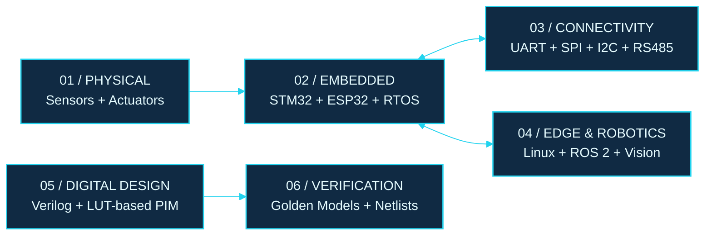

<p align="center">
  
</p>

<p align="center">
  
</p>

<p align="center">
  <a href="mailto:kksurya2023@gmail.com">
    
  </a>
  <a href="https://www.linkedin.com/in/suryak23/">
    
  </a>
  <a href="https://github.com/suryak26">
    
  </a>
  
</p>

---

## `00 / THE ENGINEERING MINDSET`

I'm Surya, an Electronics and Communication Engineering undergraduate at Sri Venkateswara College of Engineering, Chennai.

I work across embedded firmware, robotic systems, Industrial IoT, and digital hardware architecture. I'm interested in the point where software meets physical constraints: timing, power, communication, motion, and verification.

My approach is simple:

**Understand the system. Build the interface. Verify the result.**

Currently working on embedded systems and Industrial IoT at **OliveIoT**.

---

## `01 / SYSTEM MAP`

The engineering space I work in spans several layers, from physical signals to firmware, communication, robotics, and hardware architecture.



<p align="center">
  <sub>Different disciplines. One engineering mindset.</sub>
</p>

---

## `02 / SELECTED BUILDS`

These projects represent different sides of my work: hardware-aware architecture, real-time robotics, inspection systems, and connected embedded devices.

<table>
  <tr>
    <td width="50%" valign="top">
      <p align="center">
        
      </p>
      <h3>01 / ASPLUT</h3>
      <p><b>Near-Memory LUT Generator</b></p>
      <p>Exploring a serial-parallel architecture for lookup-table-centric Processing-in-Memory inference.</p>
      <p>
        
        
        
      </p>
      <ul>
        <li>28,672 LUT entries validated against an independent Python reference model, with zero mismatches.</li>
        <li>37.7% lower mapped-netlist area.</li>
        <li>51.8% lower reported total power.</li>
        <li>45.2% improvement in derived maximum frequency.</li>
      </ul>
      <p><a href="https://github.com/suryak26/SILG/tree/main/ASP_LUT"><b>Explore the RTL and verification work →</b></a></p>
    </td>
    <td width="50%" valign="top">
      <p align="center">
        
      </p>
      <h3>02 / HEXAPOD</h3>
      <p><b>Real-Time Multi-Legged Robotics</b></p>
      <p>A two-level control architecture combining deterministic low-level motion control with higher-level robotics software.</p>
      <p>
        
        
        
      </p>
      <ul>
        <li>18-servo, six-legged robotic platform.</li>
        <li>Closed-form inverse kinematics.</li>
        <li>Tripod, ripple, and wave gait generation with 50 Hz motion updates.</li>
        <li>Custom PCB integration and ROS 2 / Gazebo simulation.</li>
      </ul>
      <p><a href="https://github.com/suryak26/Hexapod"><b>Explore the robotics stack →</b></a></p>
    </td>
  </tr>
  <tr>
    <td width="50%" valign="top">
      <p align="center">
        
      </p>
      <h3>03 / ROCTARA</h3>
      <p><b>Wall-Climbing Inspection Robot</b></p>
      <p>A modular inspection platform designed around improved suction, wireless control, and computer vision.</p>
      <p>
        
        
        
      </p>
      <ul>
        <li>EDF-based suction replacing the earlier propeller-based design.</li>
        <li>RF-based wireless control and geared motor actuation.</li>
        <li>YOLO26n-seg and OpenCV-based crack measurement workflow.</li>
        <li>ROS and Gazebo work toward autonomous inspection.</li>
      </ul>
      <p><a href="https://github.com/suryak26/Roctara"><b>Explore the inspection platform →</b></a></p>
    </td>
    <td width="50%" valign="top">
      <p align="center">
        
      </p>
      <h3>04 / MOTOR HEALTH</h3>
      <p><b>Embedded Condition Monitoring</b></p>
      <p>A connected monitoring workflow that turns electrical and mechanical measurements into actionable operating states.</p>
      <p>
        
        
        
      </p>
      <ul>
        <li>Current, temperature, and vibration sensing.</li>
        <li>Threshold-based good, warning, and fault classification.</li>
        <li>Local LED and buzzer alerts.</li>
        <li>Firebase integration for remote data access.</li>
      </ul>
      <p><a href="https://github.com/suryak26/Motor-Health-Monitoring-System"><b>Explore the monitoring system →</b></a></p>
    </td>
  </tr>
</table>

<sub>ASPLUT results are from the reported comparison against an identically constrained baseline. The frequency figure is derived from the evaluation; these figures should not be interpreted as measurements from fabricated silicon.</sub>

---

## `03 / THE WORKBENCH`

<table>
  <tr>
    <td width="25%"><b>FIRMWARE</b></td>
    <td>C · C++ · STM32 · ESP32 · FreeRTOS · Zephyr · GPIO · Peripheral Drivers</td>
  </tr>
  <tr>
    <td><b>COMMUNICATION</b></td>
    <td>UART · SPI · I²C · RS485 · Modbus · LoRa · Ethernet · TCP/IP</td>
  </tr>
  <tr>
    <td><b>ROBOTICS</b></td>
    <td>ROS · ROS 2 · Gazebo · RViz · Inverse Kinematics · SLAM</td>
  </tr>
  <tr>
    <td><b>DIGITAL DESIGN</b></td>
    <td>Verilog · Icarus Verilog · RTL Verification · Python Golden Models</td>
  </tr>
  <tr>
    <td><b>EDGE & VISION</b></td>
    <td>Linux · Raspberry Pi · Python · OpenCV · YOLO26 · Flask</td>
  </tr>
  <tr>
    <td><b>HARDWARE TOOLS</b></td>
    <td>KiCad · Proteus · LTspice · STM32CubeIDE · STM32CubeMX</td>
  </tr>
</table>

---

## `04 / BEYOND THE BENCH`

Engineering isn't only firmware and circuit boards. I've also contributed to collaborative, public-facing event platforms.

- [Make-A-Thon 7.0](https://make-a-thon-7.in/) — event platform development.
- [UPAGRAHA '26](https://upagraha26.in/) — website development and frontend refinement.
- [Makeathon source repository](https://github.com/suryak26/Makeathon).

I also gained electronics manufacturing exposure at **Syrma SGS Technology Ltd**, including PCB assembly, inspection, testing, RFID manufacturing, and quality processes.

---

## `05 / SIGNALS OF PROGRESS`

| Milestone | Result |
|---|---|
| Hackerz'26 — SeedStart | Top 15 among 530+ registrations |
| Sprinthathon'25 | Top 100 among 3,500+ teams |
| IMPULSE'26 | Winner, Project Presentation |
| Upagraha'25 | First Place, Blind Chase |
| ZEPHORIA'25 | Winner, Project Expo |

**Education:** B.E. Electronics and Communication Engineering, Sri Venkateswara College of Engineering · 2023–2027 · CGPA 8.06/10

---

## `06 / ENGINEERING PRINCIPLES`

```text
01  Build across boundaries.
    Hardware, firmware, networks, and applications must work together.

02  Verify with evidence.
    Simulations, reference models, measurements, and repeatable tests matter.

03  Be precise about progress.
    Completed, under development, and planned are different states.

04  Optimize with context.
    Area, power, timing, reliability, and complexity are trade-offs.
```

---

## `07 / ESTABLISH CONTACT`

Interested in embedded firmware, real-time systems, robotics, Industrial IoT, and hardware-software integration.

<p align="center">
  <a href="mailto:kksurya2023@gmail.com">
    
  </a>
  <a href="https://www.linkedin.com/in/suryak23/">
    
  </a>
</p>

<p align="center">
  <sub>Designed around a simple idea: make the system work, then make the result measurable.</sub>
</p>

<p align="center">
  
</p>
