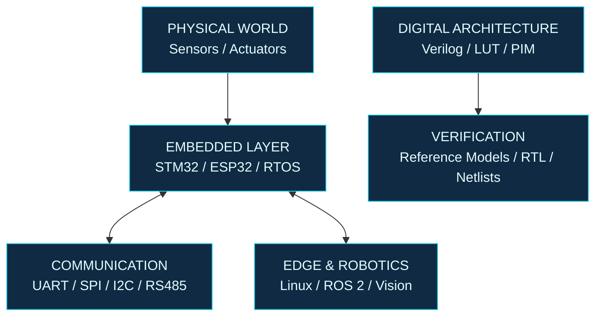

# SURYA K.

### ENGINEERING COMMAND CENTER

`EMBEDDED SYSTEMS` / `ROBOTICS` / `DIGITAL DESIGN`

**From physical signals to firmware, autonomous systems, and silicon-level optimization.**

[GitHub](https://github.com/suryak26) · [LinkedIn](https://www.linkedin.com/in/suryak23/) · [Email](mailto:kksurya2023@gmail.com)

Chennai, India · Electronics & Communication Engineering · Class of 2027

---

## `00 // SYSTEM STATUS`

| MODULE | ENGINEERING FOCUS |
|:--|:--|
| `SYS-01` | Microcontrollers, firmware, and real-time systems |
| `SYS-02` | Industrial communication and connected devices |
| `SYS-03` | Robotic control, kinematics, and simulation |
| `SYS-04` | RTL architecture, verification, and hardware optimization |

**Operating principle:** Understand the constraints. Design the system. Verify the behavior. Measure the result.

I'm an ECE undergraduate interested in how hardware and software work together under real-world constraints. My projects range from sensor-driven embedded devices and robotic control to RTL architectures for processing-in-memory inference.

Currently, I'm working in embedded systems and Industrial IoT at **OliveIoT**, while exploring hardware-aware architecture through ASPLUT.

---

## `01 // SYSTEM TOPOLOGY`

<strong>How I approach a technical problem</strong>

I like projects where the pieces must work together rather than operate as isolated demonstrations.

- **Interfaces:** Define how components communicate and what each component owns.
- **Constraints:** Account for timing, power, memory, communication reliability, and hardware limitations.
- **Verification:** Compare expected behavior against measured or simulated results.
- **Integration:** Test the complete workflow, not just the individual modules.

The exact process depends on the project. A robotic controller and an RTL design have different constraints, but both benefit from explicit interfaces and evidence-based verification.

---

## `02 // FEATURED BUILDS`

Four projects. Four different engineering challenges.

<strong>01 / ASPLUT — Hardware architecture for PIM inference</strong>

**Domain:** RTL design · Processing-in-Memory · Architecture optimization

**Repository:** [suryak26/SILG — ASPLUT implementation](https://github.com/suryak26/SILG/tree/main/ASP_LUT)

ASPLUT explores a serial-parallel lookup-table generator for LUT-centric Processing-in-Memory LLM inference. The architecture replaces spatially replicated arithmetic with a shared, time-multiplexed multiply-accumulate unit to materialize 112 half-table entries.

**Reported verification and evaluation**

| Metric | Result |
|:--|--:|
| Generated LUT entries validated | 28,672 |
| Signed activation-pair combinations | 256 |
| Verification mismatches | 0 |
| Mapped-netlist area reduction | 37.7% |
| Total power reduction | 51.8% |
| Switching power reduction | 68.3% |
| Improvement in derived maximum frequency | 45.2% |

The verification flow uses Verilog, Icarus Verilog, and an independent Python reference model.

*The performance figures are reported comparisons against an identically constrained baseline. They represent the evaluated architecture, not measurements from fabricated silicon.*

<strong>02 / HEXAPOD — Real-time control for a multi-legged robot</strong>

**Domain:** Embedded control · Robotics · RTOS · Simulation

**Repository:** [suryak26/Hexapod](https://github.com/suryak26/Hexapod)

A six-legged robotic platform designed around two control layers: an STM32 and Zephyr RTOS for real-time motion control, with a Raspberry Pi and ROS 2 for higher-level robotics functionality.

**System highlights**

- Closed-form inverse kinematics for an 18-servo platform.
- Tripod, ripple, and wave gait generation.
- Deterministic 50 Hz motion updates.
- Custom PCB for power distribution, servo control, and sensor interfacing.
- ROS 2 and Gazebo simulation for system validation.

The key design idea is separating time-critical actuation from higher-level processing so that control responsibilities remain explicit.

<strong>03 / ROCTARA — Wall-climbing inspection robotics</strong>

**Domain:** Embedded systems · Wireless control · Computer vision

**Repository:** [suryak26/Roctara](https://github.com/suryak26/Roctara)

Roctara is a redesigned wall-climbing inspection platform developed from an earlier prototype. Its design combines modular hardware, EDF-based suction, RF control, and a computer-vision workflow for crack analysis.

**Engineering highlights**

- Replaced the earlier propeller-based suction approach with an EDF-based mechanism.
- Integrated RF-based wireless control and high-torque geared motors.
- Used ROS and Gazebo for simulation work.
- Developed a crack-segmentation workflow using YOLO26n-seg and OpenCV-based analysis to estimate crack dimensions.

Autonomous inspection remains a development direction rather than a claim of fully completed autonomy.

<strong>04 / MOTOR HEALTH — Embedded condition monitoring</strong>

**Domain:** Sensor acquisition · Fault classification · Industrial IoT

**Repository:** [suryak26/Motor-Health-Monitoring-System](https://github.com/suryak26/Motor-Health-Monitoring-System)

An embedded monitoring workflow that combines current, temperature, and vibration inputs to classify operating conditions.

**Engineering highlights**

- Threshold-based good, warning, and fault states.
- Sensor acquisition and fault logic across ESP32 and STM32 firmware implementations.
- Local LED and buzzer status indications.
- Firebase integration for remote data access.

The project connects device-level monitoring with the broader goal of condition-based maintenance.

<strong>05 / EDGE IoT — Linux-based sensor platform</strong>

**Domain:** Edge computing · Linux · Peripheral integration

Configured a Raspberry Pi Zero 2 W as a local edge-IoT platform.

- Integrated environmental, motion, and gas sensors.
- Debugged I²C communication using bus scans, register inspection, and Python-based tests.
- Integrated an SPI TFT display.
- Built a local Flask application and embedded media-processing workflow using FFmpeg.

This project focuses on making sensors, peripheral communication, and user-facing software work together on a small Linux device.

---

## `03 // THE TOOLCHAIN`

<strong>Firmware & real-time systems</strong>

`C` · `C++` · `STM32` · `ESP32` · `FreeRTOS` · `Zephyr RTOS` · `GPIO` · `Raspberry Pi`

<strong>Communication & networking</strong>

`UART` · `SPI` · `I2C` · `RS485` · `Modbus` · `LoRa` · `Ethernet` · `TCP/IP` · `GSM` · `Wi-Fi`

<strong>Robotics & perception</strong>

`ROS` · `ROS 2` · `Gazebo` · `RViz` · `Inverse Kinematics` · `SLAM` · `OpenCV` · `YOLO26`

<strong>Digital design & verification</strong>

`Verilog` · `Icarus Verilog` · `RTL Verification` · `Python Golden Models` · `Netlist Evaluation`

<strong>Development & hardware tools</strong>

`Linux` · `Bash` · `Git` · `GitHub` · `STM32CubeIDE` · `STM32CubeMX` · `KiCad` · `Proteus` · `LTspice` · `Firebase` · `Flask`

---

## `04 // FIELD EXPERIENCE`

<strong>OliveIoT / Embedded Systems and IoT Intern</strong>

**July 2026 – Present · Chennai, India**

Working with STM32 and ESP32 platforms, RTOS-based firmware, peripheral integration, and industrial communication interfaces.

Technical exposure includes RS485, Modbus, LoRa, Ethernet, GSM, hardware bring-up, device testing, and Python-based test utilities.

<strong>Syrma SGS Technology Ltd / Operations Intern</strong>

**December 2025 – January 2026 · Chennai, India**

Gained exposure to electronics manufacturing, including SMT, THT, PCB assembly, soldering, inspection, ICT/FCT, RFID manufacturing, RF validation, and quality processes.

---

## `05 // VERIFIED MILESTONES`

| EVENT | OUTCOME |
|:--|:--|
| Hackerz'26 — SeedStart | Top 15 among 530+ registrations |
| Sprinthathon'25 | Top 100 among 3,500+ teams |
| IMPULSE'26 | Winner — Project Presentation |
| Upagraha'25 | First Place — Blind Chase |
| ZEPHORIA'25 | Winner — Project Expo |

**Education:** B.E. Electronics and Communication Engineering, Sri Venkateswara College of Engineering · 2023–2027 · CGPA 8.06/10

---

## `06 // ENGINEERING LOG`

<strong>What I care about when building systems</strong>

| QUESTION | WHY IT MATTERS |
|:--|:--|
| What are the timing constraints? | Real-time behavior depends on more than functional correctness. |
| Where does communication fail? | Interfaces often expose problems hidden by isolated component tests. |
| How is the result verified? | Reproducible tests are more useful than unsupported performance claims. |
| What is the actual bottleneck? | Optimization should target measured constraints, not assumptions. |
| What is complete today? | Clear implementation status keeps project documentation credible. |

<strong>Outside the hardware stack</strong>

I have also contributed to public-facing event platforms:

- [Make-A-Thon 7.0](https://make-a-thon-7.in/)
- [UPAGRAHA '26](https://upagraha26.in/)
- [Makeathon source repository](https://github.com/suryak26/Makeathon)

These projects gave me experience working with shared codebases, frontend components, event information, and iterative changes within a multi-developer team.

---

## `07 // CONTACT`

Interested in embedded firmware, real-time systems, robotics, Industrial IoT, and hardware-software integration.

| CHANNEL | LINK |
|:--|:--|
| Email | [kksurya2023@gmail.com](mailto:kksurya2023@gmail.com) |
| LinkedIn | [linkedin.com/in/suryak23](https://www.linkedin.com/in/suryak23/) |
| GitHub | [github.com/suryak26](https://github.com/suryak26) |

`END OF TRANSMISSION`

*Build deliberately. Verify rigorously. Measure honestly.*

